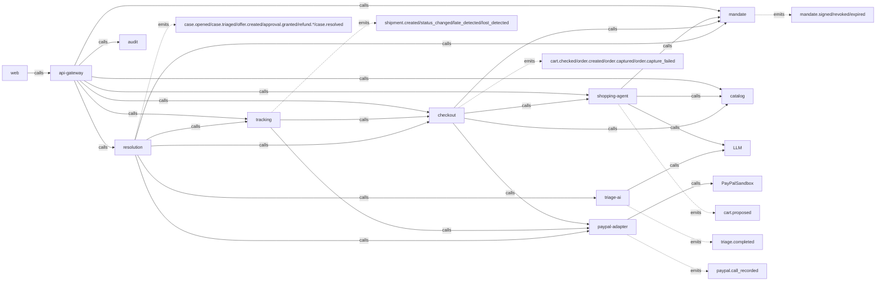

# Agent context map (knowledge graph for AI coding agents)

Purpose: load MINIMAL context per task. Read section 1 (graph), then your service's pack in section 5. Do not read the whole PRD.
Labels: V verified, I inference. Built 2026-10-10 from: `00-context-brief.md` (brief), `overview.md` (OV), `service-map.md` (SM), `adr.md` (ADR), `agent-and-mcp-design.md` (AMD), `auth-gateway.md` (AG), `threat-model.md` (TM).
Anchor style: `file#section-number` (numbered headings exist in those files). All 11 `services/<slug>/` doc sets are now written — see section 8, which is fully resolved.
Precedence when docs conflict: SM + ADR + OV win over AMD/AG/TM (older names). See section 8 drift table.

## 1. Entity types and ids
| type | ids (canonical) |
|---|---|
| service (S) | api-gateway, mandate, catalog, shopping-agent, checkout, paypal-adapter, tracking, resolution, triage-ai, audit, web |
| process (P, Profile B) | edge = {api-gateway}; core = {mandate, catalog, checkout, tracking, resolution, audit}; ai = {shopping-agent, triage-ai}; paypal = {paypal-adapter}; web (static) |
| schema (D) | gateway, mandate, catalog, agent, checkout, paypal, tracking, resolution, triage, audit (one Postgres, role per schema, ADR-004) |
| state machine (SM) | case (resolution), refund_attempt/saga (resolution + paypal-adapter), order (checkout), shipment (tracking), approval (resolution), mandate (mandate) |
| doc (DOC) | brief, OV, SM, ADR, AMD, AG, TM, deployment-zero-cost (DZ), llm-cost-and-latency (LLM) |
| threat (T) / control (C) / test (TEST) | TM#5 threats 1-15; tests T1-T22 (TM#8) |

## 2. Relationship vocabulary
`calls` (sync, downward only) | `owns` (sole writer of data) | `emits` / `consumes` (outbox event) | `guards` (control blocks threat/action) | `verified-by` (test or spike proves it) | `constrained-by` (doc/ADR/rule limits it)

## 3. Graph (text)

Sync direction is downward only; upward = events (OV#P5). Max sync depth 3.

### 3a. Services: owns / emits / consumes / calls
| S | owns (schema: tables) | emits | consumes | calls (sync) |
|---|---|---|---|---|
| api-gateway | gateway: users, sessions, key metadata | none | none | all (proxy/BFF) |
| mandate | mandate: mandates, revocations, nonces, protection_terms, outbox | mandate.signed/revoked/expired | none | none |
| catalog | catalog: merchants, items, categories, merchant_settlement_map | none | none | none |
| shopping-agent | agent: proposal_log | cart.proposed | none | catalog, mandate(read), LLM |
| checkout | checkout: carts, cart_checks, orders, captures, receipts, idempotency_keys, outbox | cart.checked, order.created/captured/capture_failed | mandate.revoked | catalog, mandate, shopping-agent(intent-fit), paypal-adapter |
| paypal-adapter | paypal: call_ledger, refund_ledger (token in memory) | paypal.call_recorded | none | PayPal sandbox |
| tracking | tracking: shipments, shipment_events, demo_clock, detector_runs, outbox | shipment.created/status_changed/late_detected/lost_detected | order.captured | paypal-adapter(add_tracking), checkout(read) |
| resolution | resolution: cases, case_transitions, offers, approvals, policy_decisions, refund_attempts, notifications, outbox | case.opened/triaged/resolved, offer.created, approval.granted, refund.requested/completed/failed/unknown | shipment.late_detected, shipment.lost_detected, mandate.revoked | triage-ai, mandate, checkout(read), tracking(read), paypal-adapter |
| triage-ai | triage: triage_log | triage.completed | none | LLM only |
| audit | audit: entries (seq, prev_hash, hash, event_id) | none | ALL events | none |
| web | none | none | none | api-gateway only |

### 3b. API endpoints (names only; source SM#2 unless noted)
- mandate: POST /mandates, GET /mandates/{id}, POST /mandates/{id}/revoke, POST /mandates/{id}/evaluate, GET /mandates/{id}/terms
- catalog: GET /items, GET /items/{id}, POST /prices/resolve
- shopping-agent: POST /propose, POST /intent-fit
- checkout: POST /carts, POST /carts/{id}/confirm, POST /orders/{id}/capture, GET /orders/{id}, GET /orders?mandate_id=
- paypal-adapter: /v1/orders, /v1/orders/{id}/capture, /v1/orders/{id}/track, /v1/captures/{id}/refund, /v1/refunds/{id}; MCP /mcp
- tracking: POST /shipments, GET /shipments/{order_id}, POST /demo/clock/advance, POST /demo/shipments/{id}/force, POST /detector/run
- resolution: POST /cases/report, GET /cases/{id}, GET /cases?status=, POST /offers/{id}/accept, POST /approvals/{token}/consent, POST /cases/{id}/merchant-action, POST /refunds/reconcile
- triage-ai: POST /classify, POST /draft, POST /brief
- audit: POST /append, GET /entries, GET /verify
- every service: /healthz, /readyz, POST /internal/events, GET /internal/outbox?after=seq, POST /internal/outbox/flush (OV#7, OV#9). Gateway: /.well-known/jwks.json, /auth/demo-session, /auth/logout (AG#2.2).

### 3c. State machines
| SM | states | owner |
|---|---|---|
| case | PROTECTED, MONITORING, PROBLEM_DETECTED, TRIAGED, OFFERED, HUMAN_REVIEW, APPROVED, REFUNDING, RESOLVED_REFUNDED, RESOLVED_RESHIP, DECLINED, CLOSED (brief#2.10) | resolution |
| refund saga | REQUESTED -> SENT -> COMPLETED / UNKNOWN -> (reconcile) COMPLETED / FAILED (OV#6) | resolution (adapter keeps backstop ledger, ADR-011) |
| order | PENDING, CAPTURE_UNKNOWN, CANCELLED_REVOKED, captured, capture_failed (OV#4 F3; full list TBD in checkout doc) | checkout |
| approval | issued, redeemed, expired, revoked (AG#4.2) | resolution |
| shipment | SIMULATED carrier states, late/lost via demo clock (full list TBD in tracking doc) | tracking |
| intent-fit | PASS < NEEDS_BUYER_CONFIRMATION < REJECT_WITH_REASON (can only tighten) | shopping-agent |

### 3d. PayPal calls (adapter MCP tool = REST)
| call | REST | status |
|---|---|---|
| OAuth token | client-credentials, ~9 h | V |
| create_order | POST /v2/checkout/orders (custom_id=mandate_id, invoice_id=order_id, same Request-Id replays same order) | V |
| buyer approve + redirect (`token`, `PayerID`) | PayPal sandbox page | V (real click); redirect INTO our server: I untested |
| capture_order | POST /v2/checkout/orders/{id}/capture -> 201 COMPLETED | V |
| add_tracking | POST /v2/checkout/orders/{id}/track (carrier OTHER); PATCH only to CANCELLED (irreversible); cannot hold late/lost | V |
| refund_capture | POST /v2/payments/captures/{id}/refund (partial ok; 422 REFUND_AMOUNT_EXCEEDED, 422 DUPLICATE_INVOICE_ID, 409 in-progress, replay returns original even if amount differs) | V |
| get_refund | GET /v2/payments/refunds/{id} | V |
| get_order, get_capture | GET /v2/checkout/orders/{id}, GET /v2/payments/captures/{id} | I (get_capture status PARTIALLY_REFUNDED observed V; exact fields untested) |
| get_tracking | GET trackers path | I (path unverified) |
| refund returning PENDING; webhooks; Disputes API; official @paypal/mcp from backend | | I untested (do not rely) |
| Fastlane, Vault v3, Agent Ready, Store Sync, WebMCP, production Payouts | | GATED: do not use |

### 3e. Guard / constrained-by edges (high value)
| control (C) | guards | where |
|---|---|---|
| deterministic mandate evaluate (hard blocks) | T3 mandate widening, T22 client money fields; AI cannot clear a block | mandate; OV#F2; TM#5.3 |
| server re-price from catalog | agent price mismatch (PRICE_MISMATCH) | checkout + catalog |
| authorization_ticket (HMAC, single-use, params match) + per-caller tool allowlist | T4 confused deputy; LLM invoking money | paypal-adapter; AMD#3 |
| persisted PayPal-Request-Id before call + adapter ledger | T1 double refund; TEST T1,T2 | resolution + paypal-adapter; ADR-011 |
| proposal_hash + single-use approval + buyer session | T2 offer manipulation; TEST T3 | resolution; AG#4.2 |
| 9 ordered pre-refund checks (list lives in resolution doc; not enumerated elsewhere) | over-refund, revoked, policy | resolution; OV#F4 |
| LLM isolation, schema validation, regex gate, fail closed | T5 prompt injection; TEST T7,T8 | shopping-agent, triage-ai; ADR-010; AMD#1 |
| gateway header strip, internal JWT (aud, <=60-120 s) | spoofed identity, bypass; TEST T14,T19 | api-gateway; AG#2,#3 |
| hash-chained audit, INSERT/SELECT role | T14 audit tamper; TEST T17 | audit |
| MONEY_ENABLED kill switch | any money action; TEST T20 | paypal-adapter; AG#6 |
| demo/clock endpoints behind operator role + env flag | T6 simulator abuse; TEST T9 | tracking |
| state-bound return URL | T8 return forgery; TEST T11 | gateway + checkout; AG#5 |

verified-by (spikes): PayPal V facts -> brief#3. Design controls -> TM#8 tests T1-T22 (P0: T1-T7, T9, T10, T13, T19, T20). LLM evals -> AMD#1 (cart ~20, intent-fit ~12, triage ~40 labelled, `evals/`).

## 4. Env var names (names only, never values)
| var | holder ONLY | note |
|---|---|---|
| PAYPAL_CLIENT_ID, PAYPAL_CLIENT_SECRET | paypal-adapter | CI env-manifest test forbids elsewhere (AG#3.2) |
| LLM_API_KEY (+ provider/model vars TBD) | shopping-agent, triage-ai | |
| SESSION_COOKIE_KEY, CSRF_KEY | api-gateway | |
| MANDATE_HMAC_KEY | mandate | |
| APPROVAL_KEY | resolution | |
| per-service signing key / trusted_issuers (names TBD) | each service | |
| MONEY_ENABLED | paypal-adapter (read every call; unreadable = false) | kill switch |
Rule: purpose-separated keys, never reuse. Secrets only in platform env; `.env.example` has names only.

## 5. Context packs (read ONLY these before coding a service)
Always (every pack): this file sec 1-4 and 6-7; brief sec 5 (principles) + sec 6 (doc rules). Skip brief sec 4 (market) unless writing demo copy.
Section refs: OV#4 F1-F5 = flows, OV#5 failures, OV#6 consistency, OV#7 contracts, OV#8 profiles; AG#2 gateway, #3 s2s, #4 mandate/approval, #5 return, #6 revoke, #7 audit stamp.

| service | MUST read | MUST NOT need (skip) |
|---|---|---|
| api-gateway | SM#2 api-gateway; ADR-006; AG#1-3, #6, #7, #10; OV#4 (route flows) + #9 | AMD (all), TM#5 beyond 7/11, brief#3 PayPal detail, other services' SM entries |
| mandate | SM#2 mandate; OV#F1, F5; AG#4.1, #6; brief#2.1,2.3; TM#5.3 + T4; ADR-004 | AMD, AG#2, #5, PayPal facts, LLM docs |
| catalog | SM#2 catalog; brief#2.2 (seed: ~12 items, 3 virtual merchants); AMD#1a (untrusted descriptions) | everything PayPal/auth/resolution |
| shopping-agent | SM#2 shopping-agent; AMD#0, #1 (1a, 1b), #2, #4, #6 scenes 1-2; ADR-010; OV#F2; LLM doc; TM#5.5 + T7 | PayPal facts, AG beyond #3.2 matrix, resolution/refund docs, MCP tool table |
| checkout | SM#2 checkout; OV#F2, F3, #5, #6; AG#5; AMD#3 (create_order/capture_order/ticket); brief#3 (orders/capture facts); ADR-011 only for ticket concept; TM#5.8, T11, T22 | AMD#1c triage, refund saga detail, tracking internals |
| paypal-adapter | SM#2 paypal-adapter; ADR-007, ADR-011; AMD#3 (all), #4; brief#3 (all); AG#3.2 + #6 kill switch; TM#5.1, 5.4, 5.9 + T1,T2,T5,T6,T12,T20 | AMD#1 (prompts/evals), catalog/tracking internals, market study |
| tracking | SM#2 tracking; OV#F4 steps 1-2; brief#3 tracking facts (PayPal cannot hold late/lost); TM#5.6 + T9; AG#2.2 demo routes | AMD, refund/saga, auth beyond service JWT |
| resolution | SM#2 resolution; OV#F4, F5, #5, #6; ADR-011; brief#2.5-2.10 + #3 refund facts; AG#4.2, #6; AMD#1c (triage contract), #2 HITL gates; TM#5.1, 5.2 + T1-T3 | AMD#1a/1b prompts, AMD MCP tool table beyond refund_capture/get_refund, catalog |
| triage-ai | SM#2 triage-ai; AMD#0, #1c, #4, #6 scenes 3-5; ADR-010; TM#5.5 + T7,T8; LLM doc | PayPal facts, mandate/auth details, MCP, checkout |
| audit | SM#2 audit; OV#7 (envelope), #6; AG#7; TM#5.14 + T17; ADR-003, ADR-004 | AMD, PayPal facts, LLM docs |
| web | SM#2 web; OV#4 flows (UI states only); brief#5 (labels: SIMULATED CARRIER, sandbox, claims to avoid) ; AG#2.3 (cookie/CORS), AG#9 (allowed claims); route list sec 3b here | all backend schemas, AMD, TM |
| cross-cutting: contracts/CI | ADR-008, ADR-009; OV#7 | everything else |
| cross-cutting: deploy | ADR-004, ADR-005; OV#8; DZ (all) | domain docs |

## 6. Glossary (canonical ids)
| term | definition | created by | consumed by |
|---|---|---|---|
| mandate_id | UUID of an immutable signed Mandate (changing terms = new mandate) | mandate (POST /mandates) | checkout (carts, `custom_id` on PayPal order), resolution (terms), shopping-agent (summary), adapter ticket |
| mandate_hash | SHA-256 of canonical JSON (RFC 8785-style) of mandate terms + policy_version + nonce | mandate | mandate (HMAC), proposal_hash input |
| nonce | single-use 128-bit value (mandate sign; also approval/CSRF nonces), stored hashed | gateway / mandate | mandate |
| policy_version | pin of the 3 hardcoded merchant policies at signing | mandate | resolution policy engine, proposal_hash |
| proposal_hash | SHA-256 of canonical {mandate_id, mandate_hash, sorted (sku, qty), server total, currency, merchant_ids, policy_version} (cart, AMD#1a); refund proposals bind capture/amount/terms (TM#5.2). Always computed by server, never model | checkout (cart), resolution (refund offer) | approval link redeem, authorization_ticket |
| authorization_ticket | short-lived, single-use HMAC claim {mandate_id, proposal_hash, op, amount_minor, exp, nonce} that unlocks an adapter money tool (I: vs callback validation still open, AMD#7) | checkout / resolution | paypal-adapter (verifies, consumes nonce) |
| case_id | UUID of a resolution case; unique key (order_id, kind) | resolution | triage, offers, approvals, refund_attempts |
| Request-Id (`PayPal-Request-Id`) | caller-generated idempotency key persisted BEFORE the PayPal call; same intent keeps the same id forever | checkout (create/capture), resolution (refund) | paypal-adapter -> PayPal (V replay semantics) |
| idempotency_key | adapter tool arg that maps 1:1 to PayPal-Request-Id; distinct from HTTP `Idempotency-Key` header on public mutating calls | callers | adapter ledger |
| event_id | UUID in event envelope; dedupe key for consumers (audit idempotent on it) | any producer outbox | all consumers |
| trace_id / X-Request-Id | per-request id minted at gateway, propagated, stamped on events/audit | api-gateway | all |
| invoice_id | PayPal purchase-unit field = internal order_id; PayPal rejects reuse for refunds (422 DUPLICATE_INVOICE_ID) | checkout (order); resolution must not reuse for refunds | PayPal |
| custom_id | PayPal purchase-unit field = mandate_id; survives onto capture (V) so capture traces to mandate | checkout | adapter checks capture belongs to ticket's mandate |
| order_id | internal checkout order UUID (distinct from paypal_order_id) | checkout | tracking, resolution |
| paypal_order_id | PayPal order id = `token` on return redirect | PayPal via adapter | checkout, return binding |
| capture_id | PayPal capture id, server-derived, stored on captures | checkout (from adapter) | resolution refund, adapter |
| refund_id | PayPal refund id | PayPal via adapter | resolution refund_attempts, get_refund |
| state (return) | 128-bit single-use value binding PayPal return to session+mandate+order | gateway/checkout | return handler (AG#5) |
| approval token | single-use signed link; DB stores sha256 + tid; redeem needs matching buyer session | resolution | buyer via UI |
| reason codes | e.g. PRICE_MISMATCH, AUTHORIZATION_MISMATCH, NOT_PERMITTED, NO_PROPOSAL, ORDER_NOT_APPROVED (AMD#3) | respective service | UI, audit |
| Profile A / B | all services separate / 4 co-located processes + web; same code boundaries | | |

## 7. Naming conventions
- Service slugs: exactly the 11 in `service-list.txt`. Python package `app/`; dirs `services/<slug>/`; hosts `hosts/{edge,core,ai,paypal}.py` (ADR-009).
- Schema = role = service short name (table 1). No cross-schema SQL/FK.
- Events: `<aggregate>.<past_tense_or_fact>` lowercase, e.g. `order.captured`; schema file `contracts/events/<name>.v1.json`; envelope `{event_id, type, version, occurred_at, producer, aggregate_id, trace_id, payload}`; additive-only within a version.
- OpenAPI: `contracts/openapi/<slug>.json`, committed, CI diff check.
- Money: integer minor units everywhere; currency USD in demo; decimal strings only inside adapter.
- Env vars: `PAYPAL_*` (adapter only — deliberate exception, see re-sync list), `LLM_*` (AI services only), purpose keys `*_KEY` (sec 4). Per-service prefix: `PS_<SLUG>_*` (e.g. `PS_CHECKOUT_DATABASE_URL`, `PS_MANDATE_ISSUER_PUBKEY`) for non-secret config and URLs. **DECIDED by the user 2026-10-10**: strict `PS_<SLUG>_*` everywhere except the `PAYPAL_*` exception.
- MCP tools: snake_case verb_noun (create_order, get_order, capture_order, get_capture, add_tracking, get_tracking, refund_capture, get_refund).
- Error codes: UPPER_SNAKE reason codes in body `{error: {code, message}, request_id}` (AG#2.1 step 8); adapter envelope `status: OK|IN_PROGRESS|REJECTED|UNKNOWN` (AMD#3). HTTP: 401 bad/missing token, 403 role/scope, 404 for /internal at gateway, 409 replay/in-progress, 429 rate limit, 503 dependency down (fail closed).
- Labels in docs: V / VC / I. UI must show SIMULATED CARRIER, sandbox, seeded catalog.
- Claims: never "PayPal-backed", "tamper-proof", "non-repudiable", "injection-proof"; say "tamper-evident", "merchant-funded via PayPal refund" (brief#5, AG#9).

## 8. Re-sync list — RESOLVED 2026-10-10 (all service docs now written; all 11 rows closed)
| topic | conflict | **resolved to** |
|---|---|---|
| service names | AG/TM/AMD use orchestrator, policy, carrier-sim, merchant-svc, ai-service, agent; mcp as separate | **SM slugs, final and in use by every service doc**: checkout+resolution split orchestrator/policy; tracking = carrier-sim; mcp inside paypal-adapter; ai = shopping-agent + triage-ai |
| refund tool name | SM/ADR-007 `create_refund`; AMD `refund_capture` | **`refund_capture`** — user-confirmed 2026-10-10, applied project-wide |
| MCP caller allowlist | SM originally gave checkout `orders/capture/track`; AMD gave add_tracking to a non-existent merchant-svc | **tracking owns `add_tracking`/`get_tracking` exclusively; checkout keeps `orders`/`capture` only** — fixed per paypal-adapter spec.md C5; service-map.md corrected 2026-10-10 |
| service-token TTL / issuer | ADR-006 gateway mints 60-120 s JWT w/ JWKS; AG#3.1 <=60 s, static trusted_issuers (no JWKS fetch) | **api-gateway spec.md is canonical**: purpose tokens 10 min general / 120 s single-use; internal service JWTs use EdDSA with a static `INTERNAL_TRUSTED_ISSUERS` map plus optional JWKS refresh (avoids cold-start dependency on the gateway) |
| money scope | AG: `money.execute` + decision_id re-verified in DB; AMD: HMAC authorization_ticket | **single signed `authorization_ticket`** — user-confirmed 2026-10-10 |
| revoke vs captured protection | OV#F5, AG#6: I, needs PM confirmation | **revoke stops future spend only; protection already earned on captured orders stands** — user-confirmed 2026-10-10 (platform-prd.md D1) |
| audit write path | SM: HTTP push `POST /append`; AG: actor fields stamped from caller token | **both, combined**: `POST /internal/events/batch` (one lock, one commit for N rows), actor fields stamped server-side from the verified service JWT, never from caller-supplied fields — per audit spec.md |
| AI service layout | AMD: one ai-service/3 routes (I); SM: two services | **SM (two)**: shopping-agent + triage-ai, confirmed by both services' own docs |
| env names for provider/model, DB URLs, issuer keys | undefined | **`PS_<SLUG>_*` strict prefix everywhere** — user-confirmed 2026-10-10, except the deliberate `PAYPAL_*` exception in paypal-adapter (see sec 4) |
| 9 ordered pre-refund checks | only counted, not enumerated anywhere | **enumerated in resolution/spec.md** (checks run in order, fail-closed, commit step persists `request_id` before the PayPal call) |
| order and shipment state lists | partial | **finalized in checkout/spec.md and tracking/spec.md** |

All rows above are now closed. No further re-sync action needed unless a future doc edit reopens one.
